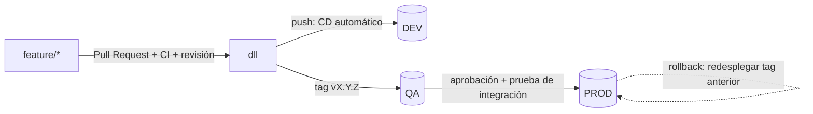

# Pruebas, CI/CD y promoción entre ambientes

## 1. Flujo de trabajo en Git

- **`dll` es la rama principal y está protegida:**
    - solo se integra por Pull Request;
    - exige la CI en verde y al menos una aprobación de *Code Owners*;
    - no permite *force push* y exige que la rama esté actualizada.
- **El desarrollo ocurre en `feature/*`**, con commits pequeños y de propósito claro.
- **Una versión es un tag semántico `vMAYOR.MENOR.PARCHE` sobre `dll`.** Ese tag es el artefacto que se promueve: el mismo código y la misma definición del job llegan a QA y a PROD.

## 2. Controles previos (CI, `.github/workflows/ci.yml`)

| Control | Qué evita |
|---|---|
| `ruff check` | Errores de estilo, imports y patrones riesgosos |
| `pytest` con cobertura ≥ 70 % | Regresiones en transformaciones, reglas, Gold, orquestación, observabilidad y gobierno (más de 90 pruebas con Spark local) |
| Validación del DAG y del modelo `JobSettings` | Jobs con ciclos, dependencias de llaves foráneas rotas, schedule incorrecto o campos inválidos |
| `scripts/verificar_contratos.py` | Cambios incompatibles en un data contract sin el incremento de versión mayor |
| `tests/test_sin_secretos.py` | Tokens, llaves o contraseñas en el repositorio; archivos de datos versionados |
| Rechazo de permisos inseguros (`plan_permisos`) | Acceso directo a tablas con datos personales para roles no autorizados |
| `databricks bundle validate` (si hay conexión configurada) | Errores de sintaxis o referencias del bundle antes de desplegar |

**Pirámide de pruebas:**

| Nivel | Qué cubre | Dónde |
|---|---|---|
| Unitarias | Fechas, hashing, contratos, reglas, deduplicación, referencias, Gold, alertas, permisos, máscaras | `tests/`, en cada PR |
| Integración local | Cadena Silver completa y Gold con reconciliación, sobre muestras con las situaciones del enunciado | `test_silver_pipeline.py`, `test_gold.py` |
| Postcondiciones | Grano, completitud, coherencia de métricas, SCD2 y frescura sobre las tablas reales | Tarea `validaciones` en cada ejecución del job |
| Integración en QA | Ejecución completa del job en QA (`modo = reproceso`) como compuerta antes de PROD | Workflow de CD |
| Monitoreo en PROD | Alertas de SLA, frescura y calidad | Tarea `observabilidad` |

**Data contracts y esquema:**
- El contrato valida el encabezado en Bronze (las columnas requeridas faltantes bloquean).
- El contrato guía el tipado y las reglas automáticas en Silver.
- La CI controla que la versión del contrato suba según el nivel del cambio:

| Nivel | Ejemplos |
|---|---|
| MAYOR | Columna eliminada, cambio de tipo, columna que pasa a requerida, dominio reducido, cambio de clave |
| MENOR | Columna opcional nueva, dominio ampliado |
| PARCHE | Solo documentación |

## 3. Ambientes

| | DEV | QA | PROD |
|---|---|---|---|
| Workspace / catálogo | Workspace de desarrollo, `dev_seguros` (en la prueba: `workspace.default`) | Workspace de QA, `qa_seguros` | Workspace productivo, `prd_seguros` |
| Despliegue | Automático en cada push a `dll` | Tag `v*` + aprobación de 1 revisor | Después de QA, aprobación de 2 revisores (datos + negocio) |
| Identidad del job | Desarrollador (`mode: development`) | *Service principal* de QA | *Service principal* de PROD (`run_as`), nunca una persona |
| Datos | Muestras sintéticas o enmascaradas | Copia enmascarada o anonimizada de producción | Datos reales |
| Schedule | Pausado | Pausado (ejecución bajo demanda) | Activo: día 5, 06:00 Colombia |

**Aislamiento:**
- Cada ambiente tiene su catálogo y sus permisos; los datos **no** se copian entre ambientes, cada uno los produce con su propio pipeline.
- Hacia ambientes inferiores solo bajan datos enmascarados.
- La autenticación desde GitHub usa **federación OIDC** con *service principals*: no hay tokens de larga vida en el repositorio ni en los secretos de GitHub.

## 4. Promoción (`.github/workflows/cd.yml`)

1. **Push a `dll`.** Se ejecuta la CI y luego `bundle validate` + `bundle deploy -t dev`.
2. **Tag `vX.Y.Z`.** Se ejecuta la CI y, con aprobación, `deploy -t qa`. Después corre una **prueba de integración**: una ejecución completa del job en QA (`bundle run ... --params fecha_corte=<prueba>,modo=reproceso`). Su tarea `validaciones` es la compuerta.
3. **Con aprobación del ambiente `prod`:** `deploy -t prod`. La primera ejecución programada queda vigilada por las alertas de SLA y calidad.

**Qué se promueve:**
- el código de `src/`, los notebooks, la configuración (`conf/`), la definición del job (`resources/`) y los parámetros por ambiente (`databricks.yml`);
- las tablas se crean o evolucionan con el propio pipeline: DDL idempotente y `MERGE WITH SCHEMA EVOLUTION`;
- los permisos, comentarios y máscaras los reaplica la tarea `gobierno` en cada ambiente.

## 5. Aprobaciones y responsabilidades

| Control | Configuración |
|---|---|
| Protección de `dll` | *Require PR*, *Require status checks* (CI), *Require review from Code Owners*, *Dismiss stale approvals* |
| Revisores por área | `.github/CODEOWNERS`: contratos y reglas también por el dueño del dato; permisos por Seguridad; despliegue por Plataforma |
| Ambientes | *GitHub Environments* `qa` y `prod` con revisores obligatorios y despliegue solo desde tags |
| Plantilla de PR | `.github/pull_request_template.md`: controles previos, impacto y plan de rollback |

## 6. Versionado de artefactos

| Artefacto | Versión |
|---|---|
| Código + job + configuración | Tag semántico `vX.Y.Z`, `CHANGELOG.md` y *GitHub Release* |
| Data contract | Campo `version` de cada contrato, controlado por la CI |
| Datos publicados | Versión Delta de cada producto Gold registrada en `ctl_publicaciones.versiones_delta` |
| Reglas de calidad y permisos | Versionados con el código (`conf/`) y revisados por PR |

## 7. Rollback

| Qué | Cómo |
|---|---|
| Código o definición del job | *Run workflow* del CD con `ambiente` y el `version` (tag) estable anterior: redespliega exactamente esa versión |
| Datos de un producto Gold | `notebooks/92_rollback_gold`: `RESTORE TABLE … TO VERSION AS OF n` con las versiones de la última publicación buena. Es auditable y reversible |
| Datos de Silver | Corregir la causa y reprocesar (`modo = reproceso`); el MERGE idempotente garantiza el mismo estado |
| Contrato o regla | *Revert* del PR, publicado como una versión nueva (nunca se reescribe un tag publicado) |

## 8. Implementación en Free Edition

Free Edition tiene un único workspace. Por eso:
- la CI corre completa en GitHub;
- el despliegue se hace con `notebooks/90_desplegar_job` usando la misma definición del bundle;
- los jobs de CD quedan inactivos mientras la variable `CD_HABILITADO` no sea `true`, sin fallar.

Para activar el CD en un entorno corporativo:
1. Crear un *service principal* por ambiente y una política de federación OIDC que confíe en el repositorio, el ambiente y los tags.
2. Crear los *GitHub Environments* `dev`, `qa` y `prod` con las variables `DATABRICKS_HOST` y `DATABRICKS_CLIENT_ID`, y con revisores en `qa` y `prod`.
3. Crear las variables de repositorio `CD_HABILITADO = true` y `FECHA_CORTE_PRUEBA`.
4. Ajustar los `host` de `databricks.yml` y los catálogos por ambiente.

**Equivalente en Azure DevOps:** *Azure Repos* con *branch policies*; *Azure Pipelines* multi-etapa (CI, DEV, QA, PROD); *Environments* con *approvals and checks*; *service connections* con federación de identidad de carga de trabajo (*workload identity federation*).
