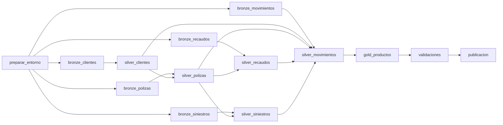

# Operación del pipeline: workflow, recuperación y acuerdos operativos

El workflow `insurance-medallion-<ambiente>` se define como código en
`resources/jobs/insurance_pipeline.job.yml` (formato Databricks Asset Bundles). Se despliega con
`notebooks/90_desplegar_job` (SDK, sin CLI) o con `databricks bundle deploy` desde CI/CD.

## 1. Flujo y dependencias

- **Bronze:** los 5 datasets se cargan en paralelo (5 tareas, el máximo concurrente de Free Edition).
- **Silver:** sigue el orden de las llaves foráneas. Una póliza necesita a su cliente, y un recaudo o siniestro necesita a su póliza.
- **Validaciones:** son una barrera. Si una postcondición de bloqueo falla, el corte no se publica.

## 2. Programación y parámetros

| Elemento | Valor |
|---|---|
| Schedule | `0 0 6 5 * ?`: día 5 de cada mes a las 06:00, zona `America/Bogota` |
| Concurrencia | `max_concurrent_runs = 1` con cola: nunca hay dos ejecuciones sobre las mismas tablas |
| `fecha_corte` | Vacío = último día del mes anterior (la ejecución del 5 de septiembre procesa agosto) |
| `modo` | `normal` (incremental por archivo y watermark) o `reproceso` (reescribe sin duplicar) |
| `job_run_id` | `{{job.run_id}}`: el mismo identificador en todas las tablas de control y de datos |
| `tipo_disparo` | `{{job.trigger.type}}`: distingue ejecuciones programadas (`PERIODIC`) de manuales |

## 3. Reintentos, timeouts y alertas

| Tareas | Timeout | Reintentos | Razón |
|---|---|---|---|
| preparar_entorno | 10 min | 1, tras 1 min | DDL idempotente; los fallos suelen ser transitorios |
| bronze_* | 15 min | 2, tras 5 min, incluso por timeout | Lectura de archivos: errores transitorios de almacenamiento |
| silver_*, gold_productos | 20 a 30 min | 1, tras 5 min | Un bloqueo de calidad es determinístico y falla de nuevo; el reintento cubre fallos de infraestructura |
| validaciones | 15 min | 0 | Una postcondición incumplida no se corrige reintentando |
| publicacion | 10 min | 1, tras 1 min | Escrituras pequeñas en tablas de control |
| Job completo | 2 h | — | Corta ejecuciones colgadas |

**Alertas:**
- **Falla:** correo al responsable del pipeline (`email_notifications.on_failure`).
- **Duración anómala:** si la ejecución supera 1 hora, se dispara la regla `RUN_DURATION_SECONDS` (`on_duration_warning_threshold_exceeded`).
- **Tablero:** el de observabilidad muestra advertencias de calidad, frescura y cumplimiento del SLA.

## 4. Idempotencia ante reejecuciones

| Capa | Mecanismo | Efecto de reejecutar con la misma entrada |
|---|---|---|
| Bronze | Hash SHA-256 del contenido del archivo y `replaceWhere _source_file_hash` | El archivo se omite (modo normal) o se reemplaza exactamente (reproceso) |
| Silver | Watermark sobre `_ingestion_ts` y `MERGE` (tipo 1, SCD2, append-only) con condiciones de versión | No hay registros nuevos; los que se reprocesan no cambian filas idénticas |
| Cuarentena | `MERGE` por (dataset, `_row_hash`, `_source_file_hash`) | El mismo rechazo queda una sola vez, con su última detección |
| Gold | `replaceWhere fecha_corte = <corte>` | El corte se reemplaza; los demás cortes no se tocan |
| Control | Filas de bitácora por `run_id` | Cada intento queda registrado; nada se sobreescribe |

## 5. Recuperación desde fallos

1. **Diagnóstico:** el correo de falla trae el enlace a la ejecución. El error de la tarea está en la ejecución misma, en `ctl_ejecuciones.mensaje` y en los logs, que llevan `run_id`, capa y dataset.
2. **Clasificación:**
   - **Infraestructura o transitorio:** los reintentos automáticos lo resuelven, o se hace *Repair run* sin cambios.
   - **Esquema (`SchemaContractError`):** la fuente cambió su contrato. Si el cambio es legítimo, se acuerda con el productor y se versiona el contrato; si no, se retira el archivo.
   - **Calidad (`DataQualityError`):** se revisan `silver_cuarentena` y `ctl_calidad_resultados`, y se escala al dueño del dato (owner del contrato).
3. **Corrección:** se corrige la causa: archivo reemplazado, contrato o regla ajustados por Pull Request, o archivo retirado (ver `notebooks/91_simular_falla`, acción `limpiar`).
4. **Reanudación:** con **Repair run** sobre la misma ejecución se reejecutan solo las tareas fallidas y sus dependientes, con los mismos parámetros y el mismo `run_id`. El watermark de Silver no avanzó en la falla, así que no se pierde ni se duplica nada.
5. **Cierre:** se verifica la ejecución en `ctl_publicaciones` y se documenta el incidente.

**Evidencia del procedimiento:** `notebooks/91_simular_falla` inyecta un archivo con claves nulas (falla de calidad) o sin una columna requerida (falla de esquema), y después lo revierte.

## 6. Backfill y reprocesos

| Necesidad | Cómo |
|---|---|
| Publicar de nuevo un corte pasado | *Run now with different parameters*: `fecha_corte = AAAA-MM-DD`, `modo = normal`. Bronze y Silver no encuentran datos nuevos; Gold recalcula ese corte |
| Reprocesar todo tras corregir una regla o un contrato | `modo = reproceso`: relee todo Bronze y hace MERGE en Silver sin duplicar |
| Varios cortes | Una ejecución por corte en orden cronológico; la cola del job las serializa. En el entorno corporativo, una tarea *For each* sobre la lista de cortes |
| Volver a una versión anterior de un producto | `RESTORE TABLE gold_x TO VERSION AS OF <n>`, con la versión registrada en `ctl_publicaciones.versiones_delta` |

## 7. Acuerdos operativos propuestos

| Indicador | Objetivo | Medición |
|---|---|---|
| Disponibilidad (SLA) | Productos Gold del mes publicados el día 5 antes de las **08:00** (Colombia), en el 95 % de los meses | `ctl_publicaciones.cumple_sla` (solo ejecuciones programadas) |
| Frescura | El dato más reciente de cada fuente tiene a lo sumo **5 días** respecto al corte (según cada contrato) | Postcondiciones `*.frescura` y `ctl_publicaciones.frescura_dias` |
| Calidad | 0 reglas de bloqueo incumplidas en lo publicado; cuarentena menor al 5 % por dataset | `gold_calidad_pipeline` |
| Duración | Menos de 1 hora por ejecución | `ctl_ejecuciones` y regla de salud del job |

**Atención de incidentes:**

| Severidad | Ejemplo | Respuesta | Solución objetivo |
|---|---|---|---|
| P1: crítica | El job falla el día 5 y el SLA está en riesgo; dato erróneo ya publicado | 30 min | Antes de las 08:00 o rollback del producto |
| P2: alta | Falla de calidad bloqueante; fuente con cambio de esquema | 2 h hábiles | 1 día hábil |
| P3: media | Advertencias de frescura o umbrales de advertencia superados | 1 día hábil | Siguiente ciclo |

**Responsables (simplificado):**

| Actividad | Ingeniería de datos | Dueño del dato (owner del contrato) | Plataforma | Consumidores |
|---|---|---|---|---|
| Operación diaria y atención de alertas | R/A | I | C | — |
| Corrección de datos en origen | C | R/A | — | I |
| Cambios de contrato o reglas | R | A | — | C |
| Incidentes de infraestructura | C | — | R/A | I |
| Uso de los productos Gold | C | I | — | R |
